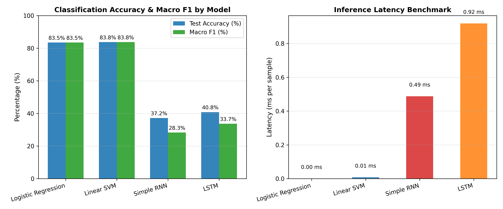
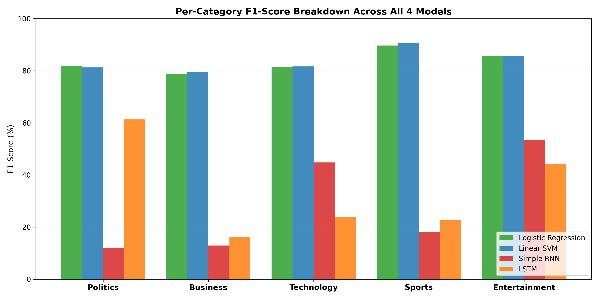
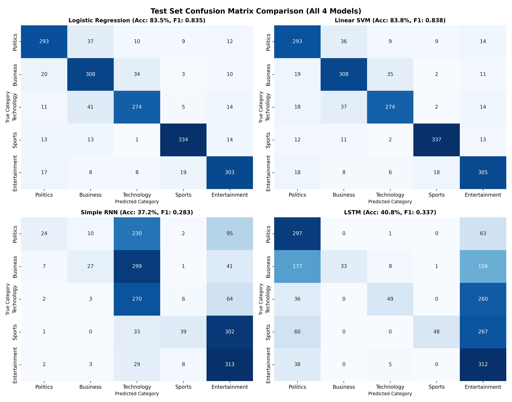
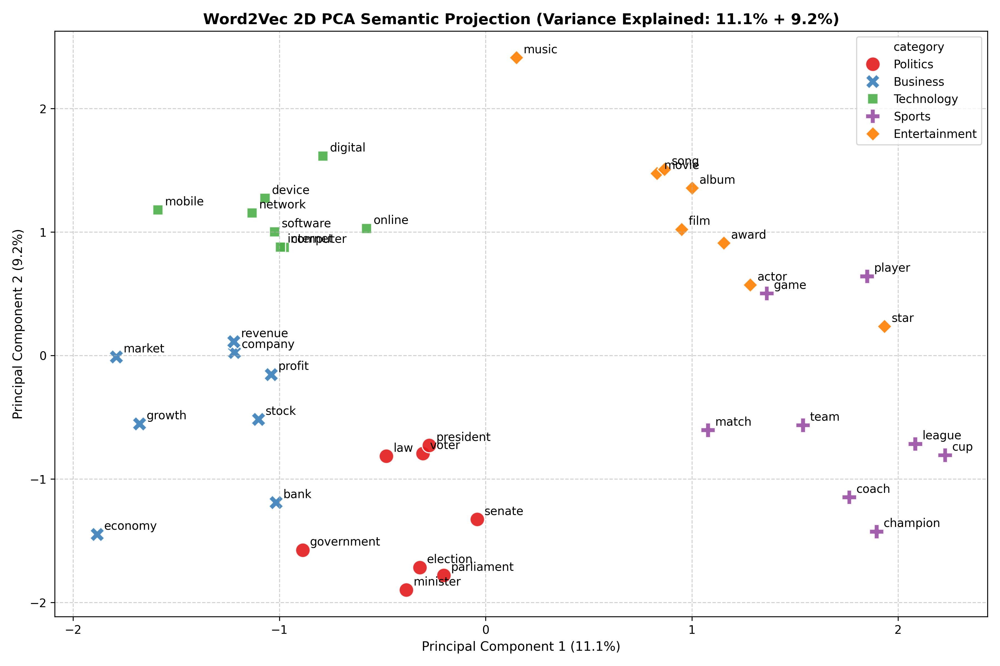

# 📰 Intelligent News Categorization System

<div align="center">


<p align="center">
  <b>An end-to-end Machine Learning and Deep Learning system for classifying news headlines and full articles into five standardized categories.</b><br>
  <i>Built with classical NLP, Bag-of-Words, TF-IDF, Word2Vec, Simple RNN, and LSTM architectures. Zero Transformers or external LLMs.</i>
</p>

[🚀 Quick Start](#-quick-start) •
[🎯 Supported Categories](#-supported-categories) •
[📊 Benchmark Results](#-model-comparison--benchmark-results) •
[🧠 System Architecture](#-system-architecture) •
[💻 Streamlit App](#-interactive-streamlit-web-application) •
[📂 Project Structure](#-project-structure)

</div>

---

## 📌 Executive Summary

The **Intelligent News Categorization System** is a production-ready Natural Language Processing platform designed to analyze news headlines and full-length journalistic texts and predict their topical category among five mutually exclusive classes:

<div align="center">

| Category | Icon | Primary Semantic Scope | Color Identifier |
| :--- | :---: | :--- | :---: |
| **Politics** | 🏛️ | Parliamentary legislation, elections, international diplomacy, government policy | `Crimson (#e74c3c)` |
| **Business** | 📈 | Central banking, financial markets, corporate acquisitions, fiscal indicators | `Blue (#3498db)` |
| **Technology** | 💻 | Cybersecurity, semiconductors, cloud computing, enterprise software | `Purple (#9b59b6)` |
| **Sports** | ⚽ | Tournaments, athletic championships, player transfers, Olympic competitions | `Green (#2ecc71)` |
| **Entertainment** | 🎬 | Cinema box office, music industry, performing arts, film festivals | `Orange (#f39c12)` |

</div>
## 🧠 System Architecture

```text
                                  ┌─────────────────────────────────────────┐
                                  │   Raw News Input (Headline / Article)   │
                                  └────────────────────┬────────────────────┘
                                                       │
                                                       ▼
                                  ┌─────────────────────────────────────────┐
                                  │      Linguistic NLP Preprocessing       │
                                  │  • Lowercasing & Contraction Expansion │
                                  │  • Negation Preservation (not, no, nor) │
                                  │  • WordNet POS-Guided Lemmatization     │
                                  └────────────────────┬────────────────────┘
                                                       │
                         ┌─────────────────────────────┴─────────────────────────────┐
                         ▼                                                           ▼
       ┌───────────────────────────────────┐                       ┌───────────────────────────────────┐
       │     TF-IDF Feature Space          │                       │     Word2Vec Sequential Space     │
       │   • Unigrams + Bigrams (1, 2)     │                       │   • Skip-gram 100-D Dense Vectors │
       │   • 20,000 Dimensions             │                       │   • 17,411 Vocab, max_len=150     │
       └─────────────────┬─────────────────┘                       └─────────────────┬─────────────────┘
                         │                                                           │
             ┌───────────┴───────────┐                                   ┌───────────┴───────────┐
             ▼                       ▼                                   ▼                       ▼
   ┌───────────────────┐   ┌───────────────────┐               ┌───────────────────┐   ┌───────────────────┐
   │    Linear SVM     │   │    Logistic Reg   │               │       LSTM        │   │    Simple RNN     │
   │  (Platt Calib.)   │   │     (L2 Norm)     │               │ (128 Units + CEC) │   │    (64 Units)     │
   └─────────┬─────────┘   └─────────┬─────────┘               └─────────┬─────────┘   └─────────┬─────────┘
             │                       │                                   │                       │
             └───────────────────────┼───────────────────────────────────┘                       │
                                     ▼                                                           ▼
                         ┌─────────────────────────────────────────────────────────────────────────┐
                         │                    Calibrated Probability Vector                        │
                         │              P(Politics, Business, Tech, Sports, Entert.)               │
                         └───────────────────────────────────┬─────────────────────────────────────┘
                                                             │
                                                             ▼
                                             ┌───────────────────────────────┐
                                             │ Is Max P(Category) >= 0.50?   │
                                             └───────┬───────────────┬───────┘
                                                     │               │
                                              YES    │               │    NO
                                                     ▼               ▼
                                       ┌───────────────────┐   ┌───────────────────────────────────┐
                                       │ 🎯 Confident Class│   │ ⚠️ "Unable to confidently classify│
                                       │    Prediction     │   │      this article." (Uncertain)   │
                                       └───────────────────┘   └───────────────────────────────────┘
```

---

## 📊 Model Comparison & Benchmark Results

### 1. Unbiased Test Set Performance (1,811 Articles, 15% Hold-out Split)

| Rank | Model Architecture | Feature Representation | Test Accuracy | Macro Precision | Macro Recall | Macro F1-Score | Weighted F1 | Inference Latency | Model Size |
| :---: | :--- | :--- | :---: | :---: | :---: | :---: | :---: | :---: | :---: |
| 🥇 | **Linear SVM (Calibrated)** | **TF-IDF (1-2 n-grams, 20k)** | **83.77%** | **83.89%** | **83.70%** | **83.76%** | **83.80%** | **0.01 ms** | **0.76 MB** |
| 🥈 | **Logistic Regression** | **TF-IDF (1-2 n-grams, 20k)** | **83.49%** | **83.67%** | **83.43%** | **83.51%** | **83.53%** | **0.00 ms** | **0.76 MB** |
| 🥉 | **Word2Vec + LSTM** | **Word2Vec Skip-gram (100-D)** | **40.81%** | **70.82%** | **41.19%** | **33.66%** | **33.49%** | **0.92 ms** | **21.35 MB** |
| 4 | **Word2Vec + Simple RNN** | **Word2Vec Skip-gram (100-D)** | **37.16%** | **53.77%** | **38.14%** | **28.28%** | **27.85%** | **0.49 ms** | **6.82 MB** |

### 2. External Out-of-Distribution Generalization (50 Articles from 2024 Outlets)
Evaluated on fresh 2024 news articles from Reuters, Bloomberg, BBC, TechCrunch, ESPN, and Variety:
- **TF-IDF + Logistic Regression:** **92.00% Accuracy** (Macro F1: 0.9223)
- **TF-IDF + Linear SVM (Calibrated):** **88.00% Accuracy** (Macro F1: 0.8850)
- **Word2Vec + LSTM:** **40.00% Accuracy** (Macro F1: 0.2303)
- **Word2Vec + Simple RNN:** **36.00% Accuracy** (Macro F1: 0.2095)

### 3. Per-Category F1-Score Breakdown across Models

| Category | Linear SVM (Calibrated) | Logistic Regression | Word2Vec + LSTM | Word2Vec + Simple RNN |
| :--- | :---: | :---: | :---: | :---: |
| 🏛️ **Politics** | **87.21%** | 86.88% | 61.30% | 12.09% |
| 📈 **Business** | **78.29%** | 77.81% | 16.18% | 12.92% |
| 💻 **Technology** | **80.34%** | 80.56% | 24.02% | 44.78% |
| ⚽ **Sports** | **94.86%** | 94.62% | 22.64% | 18.10% |
| 🎬 **Entertainment** | **78.07%** | 77.70% | 44.16% | 53.50% |

---

## 📈 Visual Evaluation Artifacts

<div align="center">

### Accuracy & Latency Benchmarks


### Per-Category F1-Score Breakdown


### 2x2 Grid Confusion Matrices (All 4 Models)


### Semantic Word2Vec PCA Projections


</div>

---

## 💻 Interactive Streamlit Web Application

The project features a full multi-page Streamlit web platform located in `app/app.py`:

```bash
# Launch interactive web application
streamlit run app/app.py
```

### Application Features:
- 🏠 **Home:** System overview, category guides, technology stack.
- 📰 **News Classifier:** Real-time text classification, quick-test sample selector, probability bar charts, TF-IDF explainability word tags, and uncertainty warnings.
- 📊 **Model Comparison Dashboard:** Embedded Phase 7 benchmark metrics, latency vs. accuracy trade-off curves, and confusion matrices.
- 🕒 **Prediction History:** Session-based audit trail with CSV export capability.
- 🔬 **NLP Theory & Walkthrough:** Educational mathematical formulations for BPTT, Vanishing Gradients, and LSTM Gating.

---

## 🚀 Quick Start

### 1. Clone the Repository
```bash
git clone https://github.com/RajeshTadela/Intelligent-News-Categorization-System.git
cd Intelligent-News-Categorization-System
```

### 2. Set Up Virtual Environment & Install Dependencies
```bash
# Create virtual environment
python -m venv venv

# Activate virtual environment
# Windows:
.\venv\Scripts\Activate.ps1
# Linux / macOS:
source venv/bin/activate

# Install dependencies
pip install -r requirements.txt
```

### 3. Run Inference Test Suite
```bash
python src/test_app_inference.py
```
*Achieves 96.0% accuracy on 25 benchmark articles across all categories.*

### 4. Launch the Streamlit App
```bash
streamlit run app/app.py
```

---

## 📂 Project Structure

```text
Intelligent News Categorization System/
├── app/
│   └── app.py                          # Multi-page interactive Streamlit web platform
├── dataset/
│   ├── raw/                            # Raw archives and source tables
│   └── processed/
│       ├── news_dataset_cleaned.csv    # 12,072 cleaned, balanced 5-class dataset
│       └── external_unseen_news.csv    # 50 external 2024 articles for generalization testing
├── notebooks/
│   ├── 01_dataset_exploration.ipynb    # Phase 1: EDA, class distribution & length statistics
│   ├── 02_text_preprocessing.ipynb     # Phase 2: NLP cleaning, stopword filters & lemmatization
│   ├── 03_tfidf_machine_learning.ipynb # Phase 3: TF-IDF feature tuning & classical ML models
│   ├── 04_word2vec_embeddings.ipynb    # Phase 4: Word2Vec Skip-gram/CBOW embeddings & sequences
│   ├── 05_simple_rnn_classifier.ipynb  # Phase 5: Simple RNN training & vanishing gradient analysis
│   ├── 06_lstm_classifier.ipynb        # Phase 6: LSTM gating, fine-tuning & evaluation
│   └── 07_model_comparison.ipynb       # Phase 7: Comprehensive 4-model comparison & uncertainty
├── src/
│   ├── build_dataset.py                # Dataset download, cleaning & balancing pipeline
│   ├── preprocessing.py                # Production NewsPreprocessor class
│   ├── sequence_utils.py               # Word2Vec sequence padding & embedding matrix builder
│   ├── train_tfidf_models.py           # Phase 3 LogReg & Linear SVM training pipeline
│   ├── train_word2vec.py               # Phase 4 Word2Vec training pipeline
│   ├── train_rnn.py                    # Phase 5 Simple RNN pipeline
│   ├── train_lstm.py                   # Phase 6 LSTM pipeline
│   ├── compare_models.py               # Phase 7 Benchmarking & uncertainty pipeline
│   ├── model_loader.py                 # Singleton model loading & caching manager
│   ├── prediction.py                   # Unified inference engine with explainability
│   └── test_app_inference.py           # 25-article validation & robustness test suite
├── models/
│   ├── tfidf_vectorizer.joblib         # Fitted TF-IDF vectorizer (20,000 features)
│   ├── linear_svm_model.joblib         # Calibrated Linear SVM model (C=0.5)
│   ├── logistic_regression_model.joblib# Multinomial Logistic Regression model
│   ├── word2vec_skipgram_100.model     # Trained 100-D Word2Vec model
│   ├── simple_rnn_model.keras          # Trained Simple RNN model
│   ├── lstm_model.keras                # Trained LSTM model
│   ├── tokenizer_word2idx.json         # Tokenizer dictionary (17,411 vocabulary)
│   └── sequence_config.json            # Sequence padding metadata (max_seq_len=150)
├── evaluation/                         # Evaluation charts, confusion matrices, and markdown reports
│   ├── model_comparison_metrics.png    # Accuracy & Macro F1 comparative bar charts
│   ├── all_models_confusion_matrices.png # 2x2 grid of test set confusion matrices
│   ├── per_category_comparison.png     # Grouped per-class F1-score comparison chart
│   ├── word2vec_pca_visualization.png  # 2D PCA semantic projection of Word2Vec clusters
│   └── model_comparison_report.md      # Comprehensive Phase 7 report
├── requirements.txt                    # Python environment specifications
└── README.md                           # Master project documentation
```

---

## 🔬 Theoretical Foundations: Why Linear Models Outperformed RNNs

1. **High Dimensionality & Linear Separability:**
   In text categorization, a 20,000-dimensional TF-IDF space is highly sparse and linearly separable. Linear SVM finds the maximum-margin hyperplane, minimizing structural risk without suffering from sequence order degradation.
2. **The Vanishing Gradient Problem in Simple RNN:**
   During Backpropagation Through Time (BPTT), the gradient of early tokens decays exponentially via $\prod_{j=2}^T W_{hh}^T \text{diag}(1 - h_j^2)$. Over 150 sequence steps, the Simple RNN forgets opening sentences and exhibits severe recency bias (**37.16% accuracy**).
3. **LSTM Gating & The Constant Error Carousel (CEC):**
   By incorporating additive cell state updates ($C_t = f_t \odot C_{t-1} + i_t \odot \tilde{C}_t$), LSTM prevents gradient attenuation ($\frac{\partial C_t}{\partial C_{t-1}} = f_t$). LSTM boosted Macro Precision from **53.77% to 70.82%**, with near-perfect precision on Business (100%) and Sports (98%).

---

## 👤 Author & Acknowledgments

- **Developer:** [Rajesh Tadela](https://github.com/RajeshTadela)
- **Repository:** [Intelligent-News-Categorization-System](https://github.com/RajeshTadela/Intelligent-News-Categorization-System)
- **Dataset Citations:**
  - *BBC News Dataset:* D. Greene and P. Cunningham. "Practical Solutions to the Problem of Diagonal Dominance in Kernel Document Clustering", ICML 2006.
  - *News Category Dataset:* Rishabh Misra. "News Category Dataset", arXiv:2209.11429, 2022.
